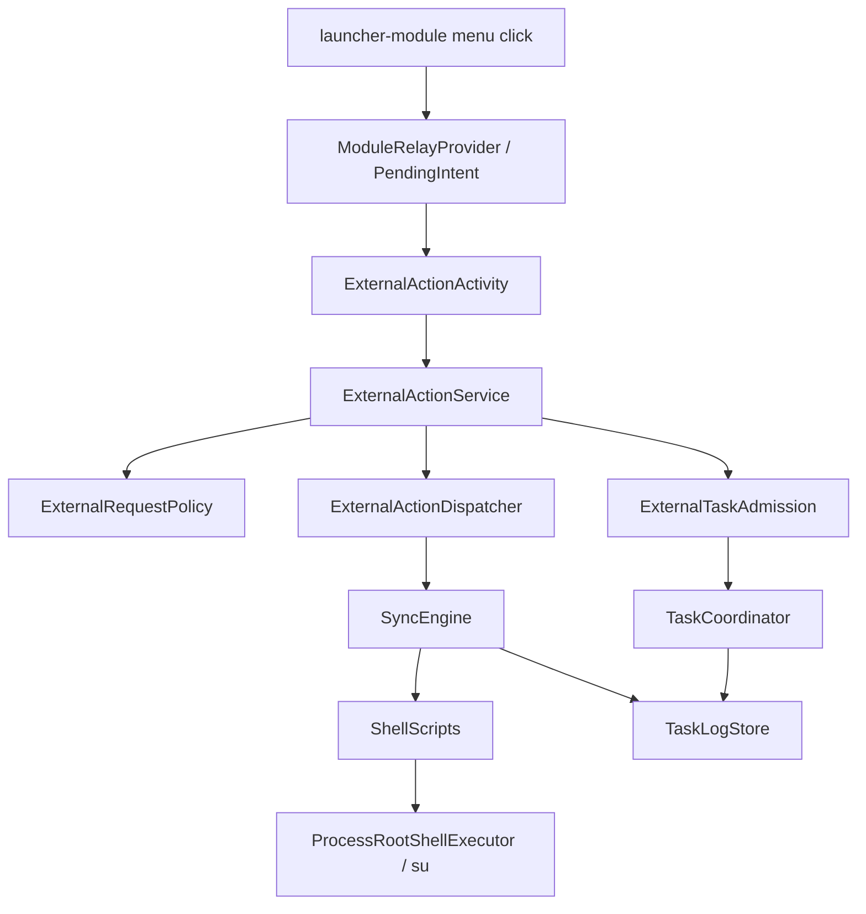

# UClone CrossUser Runtime Repo Baseline

Status: ANALYZE_AND_SCAFFOLD baseline, no production CrossUser Runtime entry wired.

## Adopted run parameters

All values below came from environment variables when present, otherwise from the task defaults.

| Parameter | Adopted value |
|---|---|
| `UCLONE_CROSSUSER_MODE` | `ANALYZE_AND_SCAFFOLD` |
| `UCLONE_REPO` | `gkeyes/uclone-restore` |
| `UCLONE_EXPECTED_BRANCH` | `0.2` |
| `UCLONE_RESEARCH_BASELINE` | `0335e8ccf3df70d7406815fde19833e7f8f01c20` |
| `UCLONE_MAIN_USER` | `0` |
| `UCLONE_CLONE_USER` | `10` |
| `UCLONE_DEVICE_SERIAL` | unset |
| `UCLONE_PROBE_PACKAGE` | `com.gkeyes.uclone.crossuserprobe` |
| `UCLONE_ALLOW_PRODUCTION_PACKAGES` | `false` |
| `UCLONE_ALLOW_SYSTEM_SERVER_HOOK` | `false` |
| `UCLONE_ALLOW_SELINUX_PERMISSIVE` | `false` |
| `UCLONE_ALLOW_REBOOT_TEST` | `false` |

## Repository baseline

| Field | Observed value |
|---|---|
| Working directory | `/Users/jianchen/Documents/ChatGPT/uclone 0.3` |
| Remote | `https://github.com/gkeyes/uclone-restore.git` |
| Branch | `0.3` |
| HEAD | `8b22264a1a40f06d40b440c6596224169def819e` |
| Tracking | `origin/0.3` |
| Worktree before scaffolding | clean |
| Prompt expected branch | `0.2` |

The actual checkout is newer than the prompt's default branch. This scaffold stays on the actual `0.3` checkout and records the mismatch instead of resetting or creating a branch.

Recent history at audit time:

```text
8b22264 Merge pull request #4 from gkeyes/codex/app-detail-ui-polish
d2a965d fix: polish app detail backup UI
c05ea63 Merge pull request #3 from gkeyes/codex/backup-named-simplified
```

## Baseline commands

```bash
pwd
git status --short --branch
git branch --show-current
git rev-parse HEAD
git log --oneline --decorate -20
find .. -name AGENTS.md -print
gradle --no-daemon test lint assembleDebug
```

Pre-scaffold Gradle result:

```text
BUILD SUCCESSFUL in 7m 25s
152 actionable tasks: 56 executed, 96 up-to-date
```

Post-scaffold validation result:

```text
bash -n tools/cross-user-lab/collect_l0.sh
bash -n tools/cross-user-lab/tests/collect_l0_self_test.sh
tools/cross-user-lab/tests/collect_l0_self_test.sh
gradle --no-daemon test lint assembleDebug
BUILD SUCCESSFUL in 41s
224 actionable tasks: 41 executed, 183 up-to-date
```

## Current module layout

Before this scaffold the root Gradle project contained:

- `:app`
- `:launcher-module`

This scaffold adds:

- `:crossuser-probe-app`

The new module is an isolated test/probe APK and is not wired into the production UI or launcher module.

## Existing architecture facts

### Main App

- `applicationId = com.uclone.restore`
- `minSdk = 29`
- `compileSdk = 36`
- `targetSdk = 36`
- current app version observed in Gradle: `0.3.0-rc.3`, `versionCode = 27`
- Kotlin/Compose app using Java 17.

`UCloneApplication.AppContainer` currently constructs the production control plane:

```text
ProcessRootShellExecutor
TaskLogStore
SyncEngine
SettingsStore
PackageInspector
LauncherShortcutController
TaskCoordinator
```

### Root execution

`RootShellExecutor` is a `su` subprocess wrapper. It first tries `su -mm -c` and then falls back to plain `su -c`. It supports streaming output and protected stdin for the clone-user credential. There is no Binder RootService or long-running privileged bridge in the current production path.

### External protocol

`ExternalActionContract.PROTOCOL_VERSION = 1`.

Existing protocol operations are finite data/user lifecycle actions, for example:

- backup and restore;
- selected backup metadata and delete;
- switch/restore data state;
- install to other user;
- start, switch to, and stop clone user;
- diagnostics and workspace maintenance.

There is no `OPEN_CROSS_USER_APP`, session, display, Surface, or input protocol yet.

### Task coordination

`TaskCoordinator` is a single finite-task busy gate backed by `TaskLogStore`. It rejects duplicate/different active requests as already-running or busy. It is appropriate for bounded backup/restore/install tasks, but it should not own long-lived interactive display sessions.

### Data plane

`SyncEngine.runScriptTask()` wraps shell scripts with `RootTaskScript`, records logs under the configured root directory, tracks task history, streams progress, parses metrics, and enforces host timeouts. Transaction-like tasks use generated shell scripts from `ShellScripts`.

`ShellScripts` includes existing user lifecycle support:

- clone CE readiness checks;
- best-effort start user;
- credential verification through `cmd lock_settings verify`;
- explicit start/stop clone user scripts;
- data capture, restore, rollback, push, and workspace index logic.

### Launcher module

The LSPosed launcher module currently injects launcher menu entries and forwards user-gesture requests to the main app through the existing external protocol. It does not own root, data, display, input, or cross-user session state.

## Call graph



## Reusable components for CrossUser Runtime

- `SettingsStore` already centralizes `mainUserId`, `cloneUserId`, root directory, and clone unlock settings.
- `RootEnvironmentChecker` already gathers root/user/CE availability signals.
- `PackageInspector` can verify whether a package exists on main and clone users.
- `TaskCoordinator` demonstrates admission semantics, but CrossUser Runtime needs a separate session coordinator.
- `ExternalActionService` and `ExternalActionContract` provide a signing/permission pattern for future protocol negotiation.
- `LauncherShortcutActionActivity` proves the launcher-to-main-app handoff pattern.

## Integration hazards

- `SyncEngine.runScriptTask()` is finite and log-oriented; a live Surface/input session must not be forced through it.
- Root shell stdout is unsuitable for high-rate input or Binder death semantics.
- Existing data scripts may stop clone user or force-stop packages; a future `ResourceGate` must block data mutations while a user10 runtime session exists.
- `ExternalActionContract` v1 must not confuse runtime open requests with existing data switch/restore operations.
- Production UI currently has no Host Activity or Surface lifecycle path.
- No device evidence has confirmed visible-background user assignment, secondary-display task placement, or display-targeted input on the target HyperOS build.
